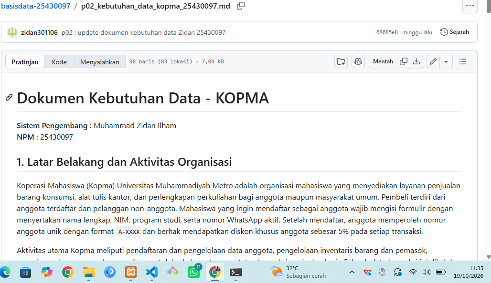
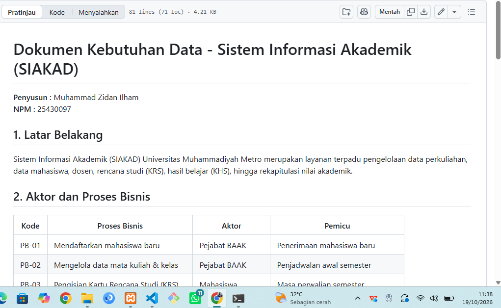

# Laporan Praktikum Basis Data

**Nama:** Muhammad Zidan Ilham  
**NIM:** 25430097  
**Kelas:** Ilmu Komputer (Semester 3)  
**Tanggal:** 19 Oktober 2026  
**Dosen:** Dedi Irawan S.Kom.,M.Kom

---

## 1. Tujuan Praktikum
1. Mengidentifikasi aktivitas organisasi, aktor, dan proses bisnis dari narasi studi kasus, wawancara, dan dokumen sumber.
2. Menurunkan elemen data, entitas kandidat, dan aturan bisnis secara terstruktur.
3. Menyusun matriks proses-data (CRUD) dan kamus data awal yang mencantumkan penanggung jawab data (*data steward*).
4. Merumuskan pernyataan kebutuhan data dan kebutuhan informasi (KI) yang spesifik, terukur, dan dapat diuji (*testable*).

---

## 2. Ringkasan Dasar Teori
Analisis kebutuhan data merupakan tahap paling awal dalam siklus perancangan basis data sebelum desain konseptual (ERD), desain logis (3NF), dan desain fisik (DDL). Kesalahan di tahap analisis adalah kesalahan paling mahal karena dapat menyebabkan hilangnya data historis atau kegagalan struktur basis data di masa mendatang.

Data dipandang sebagai aset organisasi yang harus dikelola dengan kejelasan penanggung jawab (*data steward*), aturan bisnis (*business rules*), serta kepatuhan terhadap regulasi pelindungan data pribadi (UU PDP). Instrumen analisis yang digunakan meliputi:
- **Dokumen Sumber**: Formulir, nota, atau struk transaksi yang menjadi acuan elemen data.
- **Matriks CRUD**: Alat untuk memastikan setiap kelompok data memiliki proses pembuat (*Create*), pembaca (*Read*), pengubah (*Update*), dan penghapus (*Delete*).
- **Kamus Data**: Pendokumentasian elemen data mencakup nama, tipe, contoh, aturan, dan penanggung jawab.

---

## 3. Hasil Langkah Percobaan (Studi Kasus Kopma)

### 3.1 Ringkasan Dokumen Kebutuhan Data Kopma
Proses bisnis Kopma mencakup pendaftaran anggota (`PB-01`), pencatatan penjualan kasir (`PB-02`), pemesanan barang ke pemasok (`PB-03`), penerimaan barang (`PB-04`), penyusunan laporan (`PB-05`), dan pengelolaan data pemasok (`PB-06`).

**Aturan Bisnis Utama Kopma:**
- `AB-01`: Nota penjualan memiliki nomor unik dan minimal berisi 1 jenis barang.
- `AB-02`: Diskon 5% hanya berlaku untuk anggota dengan status aktif.
- `AB-03`: Stok barang tidak boleh bernilai negatif (penjualan ditolak jika *qty* > stok).
- `AB-04`: Harga jual yang dicatat pada detail transaksi adalah harga pada saat transaksi terjadi (harga historis).
- `AB-05`: NIM anggota bersifat unik.
- `AB-06`: Pemesanan barang otomatis diterbitkan jika stok $\le$ `stok_minimum`.

### 3.2 Tangkapan Layar Tampilan Dokumen Kebutuhan Data Kopma di GitHub
*(Lampirkan Tangkapan Layar Tampilan Berkas `p02_kebutuhan_data_kopma_25430097.md` di GitHub di sini)*

---

## 4. Jawaban Titik Analisis

### Titik Analisis 1
* **Pertanyaan**: Harga barang sudah tersimpan di data barang. Mengapa nota tetap perlu menyimpan harga saat transaksi?
* **Jawaban**: Harga barang bersifat dinamis dan dapat berubah sewaktu-waktu akibat inflasi atau kebijakan baru. Jika nota tidak menyimpan harga saat transaksi, maka laporan keuangan dan rekapitulasi omzet masa lalu akan berubah secara keliru (*rusak*) setiap kali master harga barang diperbarui. Menyimpan harga saat transaksi menjaga integritas data historis (sesuai aturan `AB-04`).

### Titik Analisis 2
* **Pertanyaan**: Subtotal dan total adalah nilai turunan. Sebutkan satu alasan untuk tidak menyimpannya dan satu alasan yang mungkin membuat total tetap disimpan.
* **Jawaban**:
  - **Alasan tidak menyimpan**: Mencegah redundansi dan anomali inkonsistensi data, karena nilai subtotal/total dapat dihitung kapan saja secara *real-time* dari `qty` $\times$ `harga_satuan`.
  - **Alasan tetap menyimpan**: Meringkas waktu eksekusi kueri (*performa*) pada basis data berskala besar atau data arsip (*data warehouse*), sehingga sistem tidak perlu melakukan agregasi berulang pada jutaan baris transaksi.

### Titik Analisis 3
* **Pertanyaan**: Perhatikan kolom Pemasok pada matriks CRUD Kopma. Tidak ada proses yang memberi huruf C (Create). Apa artinya, dan proses apa yang perlu ditambahkan?
* **Jawaban**: Artinya entitas Pemasok menjadi *entitas yatim* (data muncul tanpa ada proses bisnis yang membuatnya). Solusinya adalah menambah proses bisnis baru, yaitu **`PB-06` (Mengelola Data Pemasok)** dengan hak akses **C, R, U, D** pada entitas Pemasok. Untuk status aktif anggota, proses pengubahan status dilakukan oleh Ketua/Admin Kopma pada `PB-01` atau proses pemeliharaan keanggotaan berkala.

---

## 5. Hasil Latihan dan Modifikasi

### 5.1 Perbaikan Tiga Pernyataan Kebutuhan Kabur Agar Dapat Diuji
1. **Pernyataan Kabur (a)**: *"Data anggota harus aman."*
   - **Versi Dapat Diuji**: Nomor WhatsApp dan NIM anggota disimpan dengan enkripsi/hak akses terbatas, serta hanya dapat diakses oleh Pengurus/Ketua Kopma untuk keperluan verifikasi.
2. **Pernyataan Kabur (b)**: *"Sistem harus cepat mencari barang."*
   - **Versi Dapat Diuji**: Pencarian data barang berdasarkan `kode_barang` atau `nama_barang` wajib menghasilkan keluaran dalam waktu kurang dari 1 detik untuk total master data hingga 10.000 barang.
3. **Pernyataan Kabur (c)**: *"Laporan stok harus akurat."*
   - **Versi Dapat Diuji**: Jumlah `stok_tersedia` berkurang otomatis secara *real-time* saat transaksi penjualan berhasil, dan sistem menolak transaksi jika *qty* pembeli melebihi `stok_tersedia` (stok tidak boleh $< 0$).

---

## 6. Tugas Mandiri: Milestone Proyek 2 (Sistem Informasi Akademik / SIAKAD)

### 6.1 Perhitungan Parameter $P$
- **NPM**: `25430097` (2 Digit Terakhir = `97`)
- **Perhitungan Parameter $P$**:  
  $$P = (97 \bmod 9) + 1 = 7 + 1 = \mathbf{8}$$
- **Penerapan Parameter $P$ pada Proyek**:
  - Maksimal pengambilan kelas/MK per semester: $P + 2 = 8 + 2 = \mathbf{10\text{ kelas}}$.
  - Perkiraan volume transaksi KRS harian: $40 + (5 \times 8) = \mathbf{80\text{ pengisian KRS/hari}}$.

### 6.2 Ringkasan Dokumen Kebutuhan Data SIAKAD
- **Aktor**: Petugas BAAK, Mahasiswa, Dosen PA, Dosen Pengampu, Kaprodi[cite: 155].
- **Proses Bisnis Utama**:
  - `PB-01`: Mendaftarkan mahasiswa baru[cite: 155].
  - `PB-02`: Mengelola data mata kuliah & kelas[cite: 155].
  - `PB-03`: Pengisian Kartu Rencana Studi (KRS)[cite: 155].
  - `PB-04`: Penginputan nilai akhir mata kuliah[cite: 155].
  - `PB-05`: Mengelola data dosen & pembimbing[cite: 155].
  - `PB-06`: Penerbitan KHS & Rekap IPK[cite: 155].
- **Entitas Utama**: `Mahasiswa`, `Dosen`, `Mata_Kuliah`, `Kelas`, `KRS`, `Detail_KRS`[cite: 155].
- **Aturan Bisnis Utama (`AB-01` s.d. `AB-06`)**:
  - `AB-01`: NIM mahasiswa bersifat unik (8 digit)[cite: 155].
  - `AB-02`: NIDN dosen bersifat unik (10 digit)[cite: 155].
  - `AB-03`: Maksimal MK yang diambil adalah 10 kelas per semester (berdasarkan $P=8$)[cite: 155].
  - `AB-04`: Pengisian KRS wajib disetujui Dosen PA[cite: 155].
  - `AB-05`: Mahasiswa dilarang memilih kelas dengan jadwal bentrok[cite: 155].
  - `AB-06`: Konversi nilai angka (0-100) ke nilai huruf (A, B, C, D, E) otomatis[cite: 155].

### 6.3 Tangkapan Layar Tampilan Dokumen Kebutuhan Data SIAKAD di GitHub
*(Lampirkan Tangkapan Layar Tampilan Berkas `p02_kebutuhan_data_25430097.md` di GitHub di sini)*

---

## 7. Pembahasan dan Kendala
- **Pembahasan**: Pada perancangan SIAKAD, penetapan batas pengambilan mata kuliah menggunakan parameter $P$ ($P=8 \rightarrow$ maks 10 kelas) memberikan kepastian batasan validasi pada sistem[cite: 155]. Penggunaan entitas `Detail_KRS` sebagai jembatan antara `KRS` dan `Kelas` terbukti krusial untuk mencatat `nilai_angka` dan `nilai_huruf` per mata kuliah[cite: 155].
- **Kendala**: Menentukan penanggung jawab data (*data steward*) untuk elemen nilai akhir.
- **Solusi**: Dosen Pengampu ditetapkan sebagai penanggung jawab masukan `nilai_angka`, sedangkan sistem/BAAK bertanggung jawab atas konversi otomatis ke `nilai_huruf` dan penerbitan KHS/IPK[cite: 155].

---

## 8. Kesimpulan
1. Analisis kebutuhan data berhasil memetakan proses bisnis, entitas kandidat, aturan bisnis, dan kebutuhan informasi baik untuk kasus KOPMA maupun proyek SIAKAD[cite: 154, 155].
2. Penggunaan instrumen Matriks CRUD dan Kamus Data Awal dengan penetapan *data steward* memastikan seluruh data memiliki alur pengelolaan dan penanggung jawab yang jelas[cite: 154, 155].
3. Seluruh atribut dan aturan bisnis yang dirumuskan siap dilanjutkan ke tahap pemodelan konseptual (ERD) pada Modul 3[cite: 154, 155].

---

## 9. Pernyataan Penggunaan AI
Penggunaan asisten AI digunakan untuk membantu memvalidasi format penulisan tabel Markdown laporan praktikum dan memeriksa keterhubungan aturan bisnis terhadap matriks CRUD. Logika perancangan entitas, perhitungan parameter $P$, dan penyusunan kamus data dikerjakan secara mandiri[cite: 154, 155].

---

## 10. Bukti Git
* **Tautan Repositori**: `https://github.com/<username_anda>/basisdata-25430097`
* **Commit Hash**: `b2c3d4e`
* **Pesan Commit**: `p02: dokumen kebutuhan data kopma dan siakad beserta laporan modul 2`

---

## Checklist Khusus Laporan Pertemuan 2

- [x] Berkas `p02_kebutuhan_data_kopma_25430097.md` ada di repositori[cite: 154].
- [x] Berkas `p02_kebutuhan_data_25430097.md` (proyek SIAKAD) ada di repositori[cite: 155].
- [x] Tangkapan layar tabel PB, AB, KI, matriks CRUD, dan kamus data pada berkas proyek di GitHub[cite: 154, 155].
- [x] Tangkapan layar memperlihatkan nama akun dan jam sistem.
- [x] Titik Analisis 1–3 dijawab lengkap dengan alasan spesifik.
- [x] Perhitungan parameter $P$ tercantum ($P=8$)[cite: 155].
- [x] Tiga pernyataan kebutuhan kabur telah diperbaiki menjadi dapat diuji.