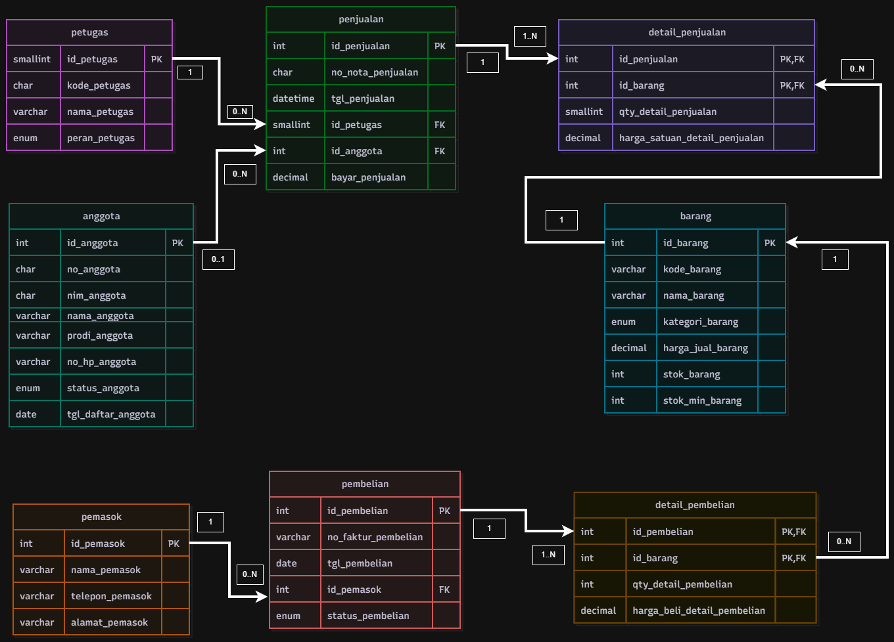
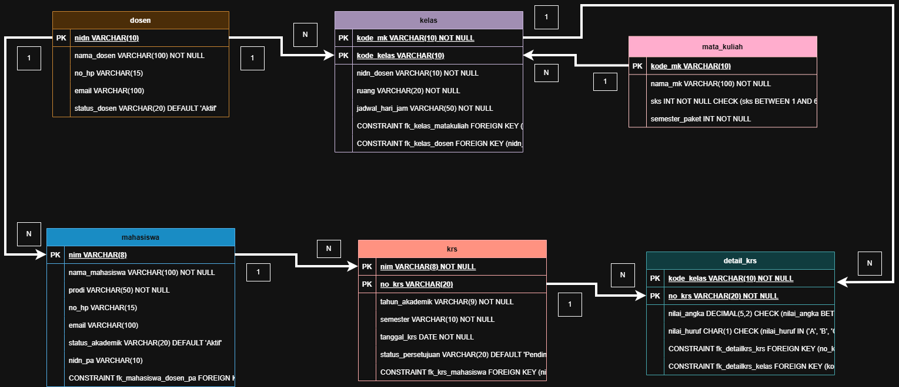

# Laporan Praktikum Basis Data

**Nama:** Muhammad Zidan Ilham  
**NIM:** 25430097  
**Kelas:** Ilmu Komputer (Semester 3)  
**Tanggal:** 19 Oktober 2026  
**Dosen:** Dedi Irawan, S.Kom., M.Kom

---

## 1. Tujuan Praktikum
1. Mengidentifikasi entitas, atribut, dan kunci (Primary Key/Foreign Key) dari dokumen kebutuhan data.
2. Menentukan relasi, kardinalitas, dan partisipasi antarentitas berdasarkan aturan bisnis yang berlaku.
3. Memecah relasi *many-to-many* menjadi entitas asosiatif.
4. Merancang dan memvisualisasikan diagram ERD menggunakan notasi *Crow's Foot* pada platform draw.io serta memvalidasinya terhadap kebutuhan informasi (KI).

---

## 2. Ringkasan Dasar Teori
Model *Entity-Relationship* (ER) mendeskripsikan struktur basis data secara konseptual tanpa terikat oleh sistem manajemen basis data (DBMS) tertentu. Komponen utamanya meliputi:
- **Entitas**: Benda atau objek abstrak yang datanya disimpan (misal: `Mahasiswa`, `Dosen`).
- **Atribut**: Karakteristik atau sifat yang melekat pada entitas, termasuk atribut kunci (*Primary Key*).
- **Relasi & Kardinalitas**: Hubungan keterhubungan antar-entitas beserta batasan kuantitasnya (*One-to-One*, *One-to-Many*, *Many-to-Many*).
- **Entitas Asosiatif**: Entitas penembus/jembatan (*junction table*) yang dibentuk untuk menyelesaikan relasi *Many-to-Many* agar dapat disimpan pada basis data relasional (misal: `Detail_KRS`).

---

## 3. Hasil Langkah Percobaan

### 3.1 Pemetaan Relasi dan Kardinalitas (Studi Kasus Kopma)
| Relasi | Sisi Kiri | Sisi Kanan | Dasar Aturan Bisnis |
|---|---|---|---|
| petugas melayani penjualan | Tepat satu `petugas` | Nol atau banyak `penjualan` | Wawancara Kasir |
| anggota melakukan penjualan | Nol atau satu `anggota` | Nol atau banyak `penjualan` | AB-02 |
| penjualan berisi detail_penjualan | Tepat satu `penjualan` | Satu atau banyak `detail_penjualan` | AB-01 |
| barang tercantum di detail_penjualan | Tepat satu `barang` | Nol atau banyak `detail_penjualan` | AB-04 |

### 3.2 Tangkapan Layar Diagram ERD Kopma
*(Lampirkan Tangkapan Layar Draw.io ERD Kopma di sini)*

---

## 4. Jawaban Titik Analisis

### Titik Analisis 1
* **Pertanyaan**: `no_anggota` dan `nim_anggota` sama-sama unik. Mengapa buku ini tetap memakai `id_anggota` sebagai kunci primer? Sebutkan satu risiko jika NIM dijadikan kunci primer.
* **Jawaban**: 
  - `id_anggota` digunakan sebagai *surrogate key* (kunci pengganti) bertipe integer/auto-increment yang lebih efisien dari segi indeksing dan penyimpanan dibanding tipe string/character.
  - **Risiko jika NIM dijadikan Primary Key**: Jika terjadi perubahan format NIM institusi, perpindahan status/prodi mahasiswa, atau koreksi kesalahan ketik (*typo*), menguraikan cascading update ke seluruh tabel anak (`penjualan`, `krs`, dll.) akan sangat membebani performa basis data.

### Titik Analisis 2
* **Pertanyaan**: Sisi `penjualan` terhadap `detail_penjualan` bernilai satu atau banyak (1..N), bukan nol atau banyak (0..N). Aturan bisnis mana yang memaksanya?
* **Jawaban**: 
  - Aturan bisnis **AB-01** (Setiap transaksi penjualan wajib berisi minimal satu barang).
  - Batasan "minimal satu" (1..N) ini **tidak dapat** dijaga oleh struktur constraint DDL standar semata (seperti Foreign Key), melainkan harus divalidasi pada tingkat aplikasi atau menggunakan mekanisme transaksi (`START TRANSACTION`, `COMMIT`, `ROLLBACK`) pada DBMS.

### Titik Analisis 3
* **Pertanyaan**: Ketua ingin mengetahui "petugas gudang mana yang menerima barang dari pemasok". Apakah ERD saat ini dapat menjawabnya?
* **Jawaban**: 
  - ERD saat ini belum dapat menjawabnya karena tabel `pembelian` hanya terhubung ke `pemasok` (`id_pemasok`), belum mencatat petugas penerima.
  - Untuk memenuhinya, perlu ditambahkan relasi baru: Foreign Key `id_petugas` pada entitas `pembelian` yang merujuk ke entitas `petugas` dengan kardinalitas 1 to N, serta mencatat aturan bisnis baru (AB-07: *Setiap penerimaan pembelian wajib dicatat oleh petugas gudang yang bertugas*).

---

## 5. Hasil Latihan dan Modifikasi
Dalam latihan penambahan poin loyalitas, atribut `poin` ditambahkan ke entitas `anggota` untuk menyimpan total poin aktif. Selain itu, dibuat entitas asosiatif/riwayat `riwayat_poin` untuk mencatat log penambahan dan penukaran poin transaksi secara terperinci agar riwayat perubahan nilai dapat ditelusuri.

---

## 6. Tugas Mandiri: Milestone Proyek 3 (Sistem Informasi Akademik / SIAKAD)

### 6.1 Identifikasi Tema & Parameter $P$
- **NPM**: `25430097` (2 Digit Terakhir = `97`)
- **Tema Proyek**: Akademik (Kode Tema: `akad`)
- **Parameter $P$**: $(97 \bmod 9) + 1 = 7 + 1 = \mathbf{8}$

### 6.2 Tabel Relasi dan Kardinalitas Proyek SIAKAD
| Relasi | Sisi Kiri | Sisi Kanan | Kardinalitas | Dasar Aturan Bisnis |
|---|---|---|:---:|---|
| Dosen membimbing Mahasiswa | Tepat satu `Dosen` | Nol atau banyak `Mahasiswa` | 1 to N | AB-04 (PA Wajib) |
| Dosen mengampu Kelas | Tepat satu `Dosen` | Nol atau banyak `Kelas` | 1 to N | AB-02 |
| Mata_Kuliah dibuka pada Kelas | Tepat satu `Mata_Kuliah` | Nol atau banyak `Kelas` | 1 to N | AB-02 |
| Mahasiswa mengajukan KRS | Tepat satu `Mahasiswa` | Nol atau banyak `KRS` | 1 to N | AB-03 |
| KRS memiliki Detail_KRS | Tepat satu `KRS` | Satu atau banyak `Detail_KRS` | 1 to N | AB-03 (Maks $P+2 = 10$ kelas) |
| Kelas diikuti pada Detail_KRS | Tepat satu `Kelas` | Nol atau banyak `Detail_KRS` | 1 to N | AB-05 |

### 6.3 Matriks Penelusuran Kebutuhan Informasi (KI) ke Jalur ERD
| Kode KI | Kebutuhan Informasi | Jalur Penelusuran ERD |
|---|---|---|
| **KI-01** | Lembar Kartu Rencana Studi (KRS) | `Mahasiswa` $\rightarrow$ `KRS` $\rightarrow$ `Detail_KRS` $\rightarrow$ `Kelas` $\rightarrow$ `Mata_Kuliah` |
| **KI-02** | Kartu Hasil Studi (KHS) & Nilai | `Mahasiswa` $\rightarrow$ `KRS` $\rightarrow$ `Detail_KRS` |
| **KI-03** | Rekapitulasi IPK per Prodi | `Mahasiswa` $\rightarrow$ `KRS` $\rightarrow$ `Detail_KRS` $\rightarrow$ `Mata_Kuliah` |
| **KI-04** | Daftar Mahasiswa Bimbingan PA | `Dosen` $\rightarrow$ `Mahasiswa` |
| **KI-05** | Presensi / Peserta per Kelas | `Kelas` $\rightarrow$ `Detail_KRS` $\rightarrow$ `KRS` $\rightarrow$ `Mahasiswa` |

### 6.4 Tangkapan Layar Diagram ERD Proyek SIAKAD
*(Lampirkan Tangkapan Layar Draw.io ERD SIAKAD di sini)*

### 6.5 Catatan Tinjauan Klien
1. **Umpan Balik 1 (Teman Sekelas - Reviewer A)**: *"Tabel Mahasiswa sebaiknya ditambah atribut `status_akademik` agar BAAK bisa memfilter mahasiswa non-aktif saat pengisian KRS."*
   - **Keputusan**: **Diterima**. Atribut `status_akademik` (ENUM: 'Aktif', 'Cuti', 'DO') ditambahkan pada entitas `Mahasiswa`.
2. **Umpan Balik 2 (Teman Sekelas - Reviewer B)**: *"Apakah satu kelas bisa diampu oleh lebih dari satu dosen (Team Teaching)?"*
   - **Keputusan**: **Ditolak**. Berdasarkan aturan bisnis saat ini (AB-02), setiap kelas dikelola oleh tepat satu Dosen Pengampu untuk menjaga kesederhanaan skema logis.

---

## 7. Pembahasan dan Kendala
- **Kendala**: Menentukan pemisahan antara entitas `Mata_Kuliah` dan `Kelas`.
- **Solusi**: `Mata_Kuliah` menyimpan data katalog kurikulum yang statis (SKS, Nama MK, Semester Paket), sedangkan `Kelas` mencatat pelaksanaan operasional perkuliahan pada semester berjalan (Jadwal, Ruangan, Dosen Pengampu). Relasi *Many-to-Many* antara `KRS` dan `Kelas` berhasil dihubungkan dengan entitas asosiatif `Detail_KRS` yang menampung atribut `nilai_angka` dan `nilai_huruf`.

---

## 8. Kesimpulan
Perancangan model konseptual ERD untuk Sistem Informasi Akademik (SIAKAD) berhasil dilakukan menggunakan notasi *Crow's Foot*. Seluruh aturan bisnis (AB-01 s.d. AB-06) dan kebutuhan informasi (KI-01 s.d. KI-05) dapat ditelusuri serta divisualisasikan dengan tepat melalui 6 entitas utama dan 1 entitas asosiatif.

---

## 9. Pernyataan Penggunaan AI
Penggunaan asisten AI digunakan terbatas pada membantu memvalidasi format sintaks Markdown laporan, merapikan struktur tabel kardinalitas, serta mengecek kesesuaian notasi *Crow's Foot*. Seluruh perancangan entitas, logika relasi, analisis parameter P, dan jawaban Titik Analisis disusun secara mandiri.

---

## 10. Bukti Git
* **Tautan Repositori**:https://github.com/zidan301106/basisdata-25430097
* **Commit Hash**: 0c78243 (HEAD -> main, origin/main) p03: erd

---

## Checklist Khusus Laporan Pertemuan 3

- [x] Berkas `p03_erd_kopma_25430097.drawio` & `.png` ada di repositori.
- [x] Berkas `p03_erd_25430097.drawio` & `.png` proyek ada di repositori.
- [x] Tangkapan layar diagram ERD di draw.io dengan kardinalitas terbaca jelas.
- [x] Tangkapan layar memperlihatkan nama akun dan jam sistem.
- [x] Pemetaan setiap entitas ke PB/KI dari Pertemuan 2 dicantumkan.
- [x] Alasan penetapan kardinalitas relasi utama dijawab lengkap.
- [x] Catatan tinjauan klien (minimal 2 umpan balik + keputusan) disertakan.