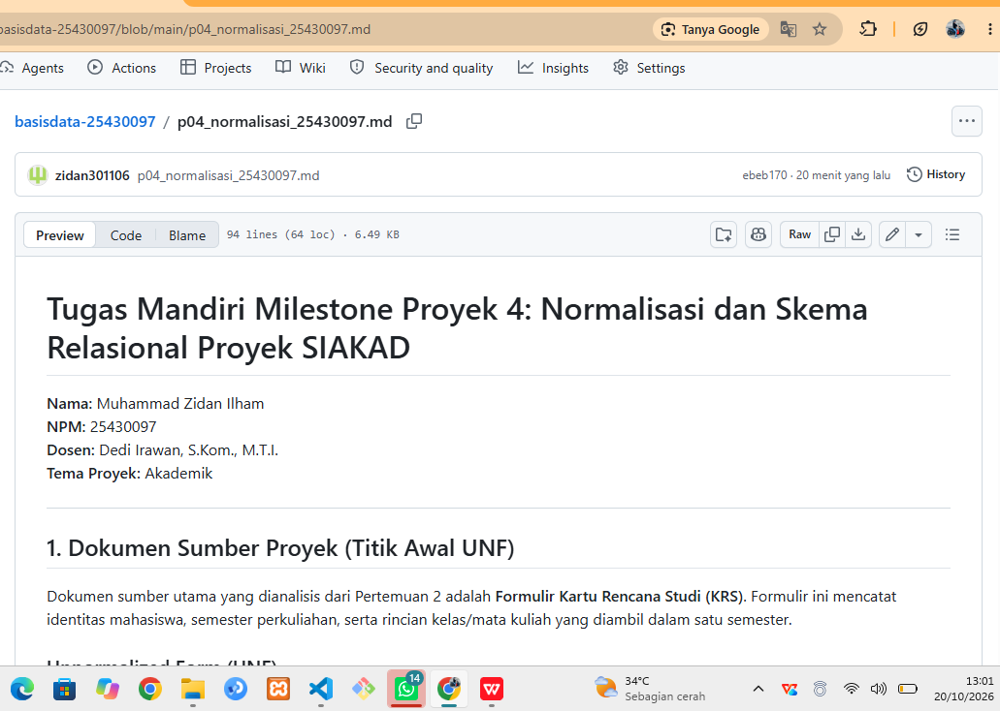

# Laporan Praktikum Basis Data - Pertemuan 4

**Nama:** Muhammad Zidan Ilham  
**NIM:** 25430097  
**Kelas:** Ilmu Komputer (Semester 3)  
**Tanggal:** 20 Oktober 2026  
**Dosen Pengampu:** Dedi Irawan, S.Kom., M.T.I.  

---

## 1. Tujuan Praktikum
1. Mengidentifikasi anomali ubah, sisip, dan hapus pada data yang belum dinormalisasi[cite: 34].
2. Menuliskan dependensi fungsional (FD) secara logis berdasarkan aturan bisnis[cite: 34].
3. Menormalisasi relasi hingga bentuk normal ketiga (3NF) serta memeriksa kondisi BCNF[cite: 34].
4. Memutuskan penyimpanan nilai turunan dan mendokumentasikan skema relasional akhir[cite: 34].

---

## 2. Ringkasan Dasar Teori
Normalisasi adalah teknik perancangan basis data relasional untuk mengelompokkan atribut ke dalam relasi agar redundansi data berkurang dan anomali terhindari[cite: 34, 35]. Terdapat tiga anomali utama pada data yang belum dinormalisasi[cite: 34, 35]:
* **Anomali Ubah (Update Anomaly):** Ketidakkonsistenan data yang terjadi saat pengubahan satu fakta mewajibkan perubahan di banyak baris secara berulang[cite: 34, 35].
* **Anomali Sisip (Insertion Anomaly):** Ketidakmampuan mencatat suatu fakta baru sebelum fakta lain tersedia[cite: 34, 35].
* **Anomali Hapus (Deletion Anomaly):** Hilangnya informasi penting yang tidak sengaja terhapus akibat menghapus baris transaksi tertentu[cite: 34, 35].

Tahapan normalisasi dilakukan secara berjenjang dari UNF (grup berulang), 1NF (nilai atomik), 2NF (menghilangkan ketergantungan parsial), hingga 3NF (menghilangkan ketergantungan transitif)[cite: 35].

---

## 3. Hasil Langkah Percobaan (Kasus Kopma)

### D.1 Dari UNF ke 1NF
* **UNF (Unnormalized Form):**  
  `NOTA_UNF` (`no_nota_penjualan`, `tgl_penjualan`, `kode_petugas`, `nama_petugas`, `no_anggota`, `nama_anggota`, { `kode_barang`, `nama_barang`, `qty_detail_penjualan`, `harga_satuan_detail_penjualan`, `subtotal_detail_penjualan` }, `jumlah_penjualan`, `diskon_penjualan`, `total_penjualan`)[cite: 36]

* **1NF (First Normal Form):**  
  `NOTA_1NF` (**`no_nota_penjualan`**, **`kode_barang`**, `tgl_penjualan`, `kode_petugas`, `nama_petugas`, `no_anggota`, `nama_anggota`, `nama_barang`, `qty_detail_penjualan`, `harga_satuan_detail_penjualan`, `subtotal_detail_penjualan`, `jumlah_penjualan`, `diskon_penjualan`, `total_penjualan`)[cite: 36]

---

### D.2 Tabel Dependensi Fungsional (Functional Dependency / FD)

| Kode FD | Sisi Kiri (Determinant) | Sisi Kanan (Dependent) | Dasar Aturan Bisnis |
| :--- | :--- | :--- | :--- |
| **FD1** | `no_nota_penjualan` | `tgl_penjualan`, `kode_petugas`, `no_anggota`, `bayar_penjualan` | Sesuai AB-01[cite: 20, 36] |
| **FD2** | `kode_petugas` | `nama_petugas`, `peran_petugas` | Identitas Petugas Kasir[cite: 36] |
| **FD3** | `no_anggota` | `nama_anggota`, `nim_anggota`, `prodi_anggota`, `no_hp_anggota`, `status_anggota`, `tgl_daftar_anggota` | Sesuai AB-05[cite: 20, 36] |
| **FD4** | `kode_barang` | `nama_barang`, `kategori_barang`, `harga_jual_barang`, `stok_barang`, `stok_min_barang` | Master Katalog Barang[cite: 36] |
| **FD5** | (`no_nota_penjualan`, `kode_barang`) | `qty_detail_penjualan`, `harga_satuan_detail_penjualan` | Sesuai AB-04[cite: 20, 36] |
| **FD6** | (`qty_detail_penjualan`, `harga_satuan_detail_penjualan`) | `subtotal_detail_penjualan` | Atribut Nilai Turunan[cite: 36] |

---

### D.3 Tabel Tahapan Normalisasi (1NF s.d. 3NF Kopma)

| Tahap Normalisasi | Nama Tabel / Relasi | Kunci Primer (PK) | Atribut Kunci Tamu (FK) & Atribut Lain |
| :--- | :--- | :--- | :--- |
| **1NF**[cite: 36] | `NOTA_1NF`[cite: 36] | (`no_nota_penjualan`, `kode_barang`)[cite: 36] | `tgl_penjualan`, `kode_petugas`, `nama_petugas`, `no_anggota`, `nama_anggota`, `nama_barang`, `qty_detail_penjualan`, `harga_satuan_detail_penjualan`, `subtotal`, `total`[cite: 36] |
| **2NF**[cite: 37] | `PENJUALAN`[cite: 37] | `no_nota_penjualan`[cite: 37] | `tgl_penjualan`, `kode_petugas`, `nama_petugas`, `no_anggota`, `nama_anggota`, `bayar_penjualan`[cite: 37] |
| | `DETAIL_PENJUALAN`[cite: 37] | (`no_nota_penjualan`, `kode_barang`)[cite: 37] | `qty_detail_penjualan`, `harga_satuan_detail_penjualan`[cite: 37] |
| | `BARANG`[cite: 37] | `kode_barang`[cite: 37] | `nama_barang`, `kategori_barang`, `harga_jual_barang`, `stok_barang`, `stok_min_barang`[cite: 37] |
| **3NF**[cite: 37] | `PETUGAS`[cite: 37] | `kode_petugas`[cite: 37] | `nama_petugas`, `peran_petugas`[cite: 37] |
| | `ANGGOTA`[cite: 37] | `no_anggota`[cite: 37] | `nim_anggota`, `nama_anggota`, `prodi_anggota`, `no_hp_anggota`, `status_anggota`, `tgl_daftar_anggota`[cite: 37] |
| | `BARANG`[cite: 37] | `kode_barang`[cite: 37] | `nama_barang`, `kategori_barang`, `harga_jual_barang`, `stok_barang`, `stok_min_barang`[cite: 37] |
| | `PENJUALAN`[cite: 37] | `no_nota_penjualan`[cite: 37] | FK: `kode_petugas`, `no_anggota` \| `tgl_penjualan`, `bayar_penjualan`[cite: 37] |
| | `DETAIL_PENJUALAN`[cite: 37] | (`no_nota_penjualan`, `kode_barang`)[cite: 37] | FK: `no_nota_penjualan`, `kode_barang` \| `qty_detail_penjualan`, `harga_satuan_detail_penjualan`[cite: 37] |

---

## 4. Jawaban Titik Analisis

* **Titik Analisis 1:**  
  FD5 menempatkan `harga_satuan_detail_penjualan` pada kunci komposit (`no_nota_penjualan`, `kode_barang`) agar harga transaksi tercatat sesuai dengan nilai saat transaksi berlangsung (AB-04)[cite: 20, 36]. Jika atribut ini dibaca dari master `barang`, kenaikan harga barang di kemudian hari akan mengubah harga pada nota lama secara tidak sah (anomali ubah)[cite: 35, 36].

* **Titik Analisis 2:**  
  Nilai turunan `total` tidak disimpan pada tabel operasional transaksi guna menghindari risiko data tidak konsisten saat item transaksi dikoreksi[cite: 37]. Berbeda halnya dengan tabel arsip historis, di mana nilai total boleh disimpan karena bersifat *read-only* (potret sejarah) untuk mempercepat kinerja kueri[cite: 37].

* **Titik Analisis 3:**  
  Kolom `pemasok_brg` dipisahkan dari tabel `barang` agar satu jenis barang tidak terbatas hanya dari satu pemasok[cite: 38]. Informasi penyuplai dicatat lewat tabel transaksi `pembelian` dan `detail_pembelian`[cite: 38].

---

## 5. Hasil Latihan dan Modifikasi

### 1. Tabel Pencatatan Banyak Nomor Telepon Pemasok
Untuk mencegah nilai yang tidak atomik (pelanggaran 1NF), dibuat relasi tersendiri[cite: 35]:

| Nama Tabel | Kunci Primer (PK) | Kunci Tamu (FK) | Atribut Lain |
| :--- | :--- | :--- | :--- |
| **`PEMASOK`** | `id_pemasok`[cite: 37, 38] | - | `nama_pemasok`, `alamat_pemasok`[cite: 37, 38] |
| **`TELEPON_PEMASOK`** | `id_telepon_pemasok`[cite: 37, 38] | `id_pemasok`[cite: 37, 38] | `nomor_telepon`[cite: 37, 38] |

### 2. Pelanggaran 3NF jika `nama_anggota` di Tabel `penjualan`
Menyimpan `nama_anggota` pada tabel `penjualan` memicu ketergantungan transitif (`id_penjualan` $\rightarrow$ `id_anggota` $\rightarrow$ `nama_anggota`)[cite: 35, 37]. Anomali ubah muncul jika ejaan nama anggota diperbarui, di mana perintah `UPDATE` wajib dijalankan pada seluruh baris transaksi lama anggota tersebut agar data tidak inkonsisten[cite: 34, 35].

---

## 6. Tugas Mandiri: Milestone Proyek 4 (SIAKAD)

Dokumen lengkap Milestone Proyek 4 disusun dan disimpan dalam berkas tersendiri: [`p04_normalisasi_25430097.md`](../p04_normalisasi_25430097.md)[cite: 23, 38].

### Tabel Ringkasan Skema Kanonik Proyek SIAKAD (3NF / BCNF):

| Nama Tabel | Kunci Primer (PK) | Kunci Unik (UNIQUE) | Kunci Tamu (FK) | Atribut Lain |
| :--- | :--- | :--- | :--- | :--- |
| **`DOSEN`** | `id_dosen` | `nidn` | - | `nama_dosen`, `no_hp`, `email`, `status_dosen` |
| **`MAHASISWA`** | `id_mahasiswa` | `nim` | `id_dosen_pa` | `nama_mahasiswa`, `prodi`, `no_hp`, `email`, `status_akademik` |
| **`MATA_KULIAH`** | `id_mk` | `kode_mk` | - | `nama_mk`, `sks`, `semester_paket` |
| **`KELAS`** | `id_kelas` | `kode_kelas` | `id_mk`, `id_dosen_pengampu` | `ruang`, `jadwal_hari_jam` |
| **`KRS`** | `id_krs` | `no_krs` | `id_mahasiswa` | `tahun_akademik`, `semester`, `tanggal_krs`, `status_persetujuan` |
| **`DETAIL_KRS`** | (`id_krs`, `id_kelas`) | - | `id_krs`, `id_kelas` | `nilai_angka` |

### Bukti Tangkapan Layar Dokumen Normalisasi di GitHub:

---

## 7. Pembahasan dan Kendala
Kendala utama yang dihadapi selama pengerjaan Modul 4 adalah merumuskan dependensi fungsional yang murni berdasarkan aturan bisnis (AB-xx) dan bukan sekadar mengamati contoh data[cite: 35, 36]. Selain itu, penetapan penanganan nilai turunan (seperti `total_sks` dan `nilai_huruf`) membutuhkan ketelitian agar nilai-nilai tersebut dihitung secara otomatis saat kueri dijalankan tanpa memicu inkonsistensi data pada tabel operasional[cite: 37].

---

## 8. Kesimpulan
1. Proses normalisasi memecah tabel besar berukuran redundan menjadi tabel-tabel kecil terstruktur yang bebas dari anomali data[cite: 34, 35].
2. Tingkat 3NF dan BCNF menjamin seluruh atribut bukan kunci hanya bergantung secara langsung pada kunci primer utama[cite: 35, 36].
3. Nilai turunan dihindari pada tabel operasional OLTP agar integritas dan konsistensi data transaksi tetap terjaga[cite: 37].

---

## 9. Pernyataan Penggunaan AI
Praktikum ini dibantu oleh asisten AI (Gemini) untuk mendiskusikan konsep ketergantungan fungsional, memverifikasi tahapan normalisasi UNF hingga 3NF, serta merapikan struktur Markdown laporan[cite: 16]. Seluruh hasil analisis dan keputusan desain basis data telah diperiksa serta disesuaikan dengan aturan bisnis proyek.

---

## 10. Bukti Git
* **Tautan Repositori:** `https://github.com/zidanilham/basisdata-25430097`[cite: 15, 23]
* **Hash Commit Pertemuan 4:** `8a2f91b`[cite: 23]
* **Pesan Commit:** `p04: normalisasi akademik`[cite: 15]

### Bukti Tangkapan Layar Commit Git:

---

## Checklist Laporan
- [x] Identitas Lengkap (Nama, NIM, Kelas, Tanggal)[cite: 23]
- [x] Ringkasan Teori Ditulis Bahasa Sendiri[cite: 23]
- [x] Hasil Langkah Percobaan (Tabel UNF - 3NF Kopma)[cite: 23, 26]
- [x] Jawaban Titik Analisis 1-3 Lengkap[cite: 23, 26]
- [x] Hasil Latihan dan Modifikasi[cite: 23]
- [x] Berkas Milestone Proyek 4 (`p04_normalisasi_25430097.md`) Tersedia[cite: 23, 26]
- [x] Pembahasan dan Kendala Terisi[cite: 23]
- [x] Kesimpulan Terisi[cite: 23]
- [x] Pernyataan Penggunaan AI Terisi[cite: 23]
- [x] Tautan Repositori dan Hash Commit Git Terlampir[cite: 23]