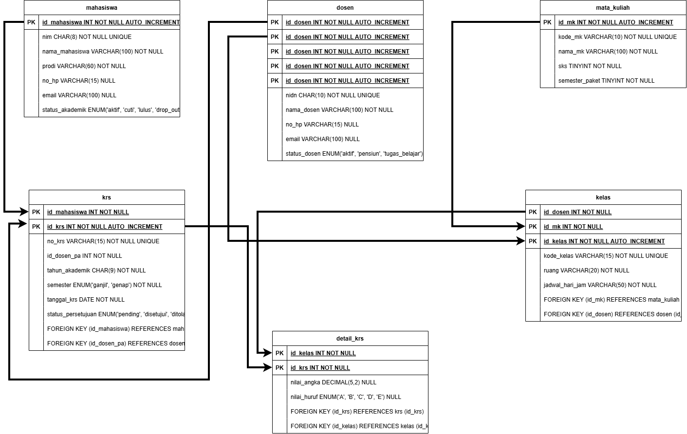
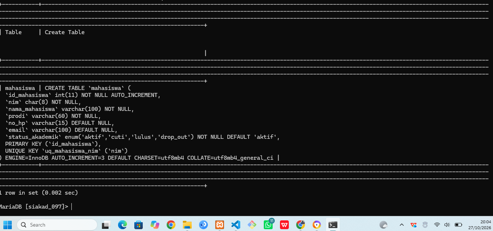
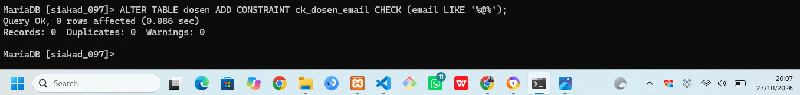
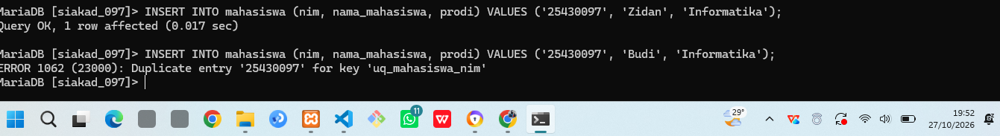

# Laporan Praktikum Modul 5: DDL dan Constraint Proyek (SIAKAD)

- **Nama**: Muhammad Zidan Ilham
- **NPM**: 25430097
- **Tema Proyek**: Akademik (SIAKAD)
- **Database**: `siakad_097`

---

## 1. Pendahuluan

Pada praktikum Modul 5 ini, dilakukan perancangan dan implementasi *Data Definition Language* (DDL) serta *Constraint* integritas data untuk sistem informasi akademik (SIAKAD). Perancangan ini bertujuan untuk memastikan integritas referensial dan validasi data pada tingkat basis data menggunakan MariaDB/MySQL.

Dalam proyek SIAKAD ini, dibuat 6 tabel utama:
1. `mahasiswa` (Tabel Induk)
2. `dosen` (Tabel Induk)
3. `mata_kuliah` (Tabel Induk)
4. `kelas` (Tabel Transaksi Perkuliahan)
5. `krs` (Tabel Transaksi Kepala KRS)
6. `detail_krs` (Tabel Detail Transaksi KRS)

---

## 2. Hasil Implementasi dan Dokumentasi

### 2.1 Eksekusi Skrip DDL dan Struktur Database

Seluruh tabel dibuat menggunakan skrip SQL DDL `p05_ddl_25430097.sql` dengan urutan pembuatan dari tabel induk terlebih dahulu, diikuti tabel transaksi dan detail transaksi.

*Gambar 2.1: Tampilan 6 tabel proyek SIAKAD yang telah berhasil dibuat pada basis data `siakad_097`.*

---

### 2.2 Struktur Diagram ERD Fisik Proyek

Berikut adalah perancangan ERD Fisik proyek SIAKAD yang menampilkan relasi antar-tabel (*Foreign Key*), penentuan *Primary Key*, serta tipe data masing-masing atribut.

*Gambar 2.2: Diagram ERD Fisik 6 tabel SIAKAD beserta atribut dan relasinya.*

---

### 2.3 Pemeriksaan Struktur Tabel (`SHOW CREATE TABLE`)

Untuk memverifikasi bahwa *constraint* `UNIQUE`, `DEFAULT`, dan *Primary Key* telah terpasang dengan benar pada tabel `mahasiswa`, dilakukan pengecekan struktur tabel menggunakan MariaDB CLI.

*Gambar 2.3: Perintah `SHOW CREATE TABLE mahasiswa` yang mengonfirmasi keberadaan PRIMARY KEY dan UNIQUE KEY (`uq_mahasiswa_nim`).*

---

### 2.4 Modifikasi Struktur Tabel (`ALTER TABLE`)

Pengujian penambahan *constraint* secara terpisah dilakukan menggunakan perintah `ALTER TABLE` untuk menambahkan aturan *CHECK constraint* pada tabel `dosen`.

*Gambar 2.4: Perintah `ALTER TABLE dosen ADD CONSTRAINT ck_dosen_email CHECK (email LIKE '%@%');` yang berhasil dieksekusi.*

---

### 2.5 Pengujian Validasi Constraint (Error Handling)

Pengujian dilakukan untuk membuktikan bahwa *constraint* `UNIQUE` pada kolom `nim` bekerja menolak data ganda. Memasukkan dua baris data dengan NIM yang sama (`25430097`) menghasilkan penolakan otomatis dari sistem MariaDB.

*Gambar 2.5: Penolakan data oleh MariaDB dengan pesan `ERROR 1062 (23000): Duplicate entry '25430097' for key 'uq_mahasiswa_nim'`.*

---

## 3. Kesimpulan

1. Skrip DDL untuk 6 tabel SIAKAD (`mahasiswa`, `dosen`, `mata_kuliah`, `kelas`, `krs`, `detail_krs`) telah berhasil diimplementasikan pada database `siakad_097`.
2. Integrasi *constraint* (`PRIMARY KEY`, `FOREIGN KEY`, `UNIQUE`, `CHECK`, dan `ON DELETE CASCADE`) terbukti efektif menjaga konsistensi serta mencegah manipulasi data yang tidak valid.
3. Penegakan *constraint* pada tingkat kernel DBMS MariaDB terbukti mampu menolak transaksi anomali secara otomatis, seperti terbukti pada munculnya galat `ERROR 1062` saat input NIM duplikat.
4. Penerapan aturan eksekusi DDL yang benar (menghapus tabel dari tabel anak ke tabel induk dan membuat tabel dari tabel induk ke tabel anak) menjamin tidak timbulnya galat ketergantungan relasional (*foreign key dependency*).
5. Seluruh dokumentasi eksekusi DDL, gambar ERD fisik, dan uji coba penolakan *constraint* telah terarsip dengan baik di repositori Git.