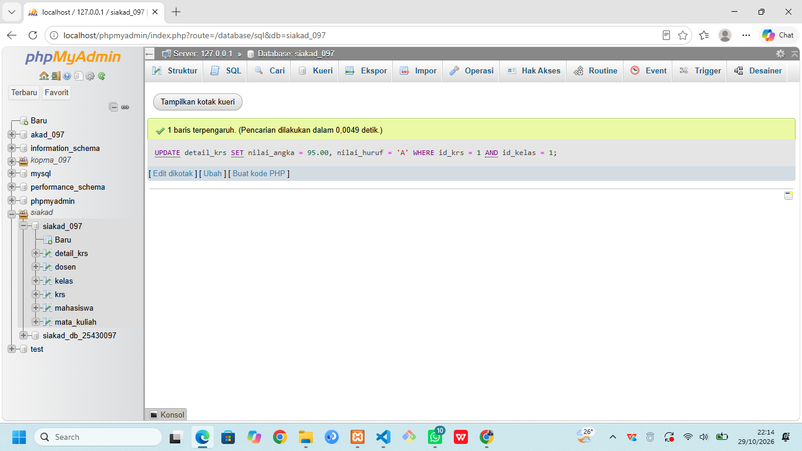
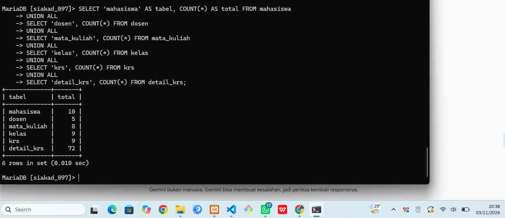

# LAPORAN PRAKTIKUM BASIS DATA
## MODUL 6: DATA MANIPULATION LANGUAGE (DML)

**Disusun Oleh:**
- **Nama** : Muhammad Zidan Ilham
- **NIM**  : 25430097
- **Kelas** : Informatika
- **Parameter Praktikum ($P$)**: $(97 \bmod 9) + 1 = 8$

---

## BAB I: PENDAHULUAN

### 1.1 Latar Belakang
Data Manipulation Language (DML) merupakan sub-bahasa SQL yang digunakan untuk mengelola dan memanipulasi data di dalam objek basis data yang telah didefinisikan sebelumnya melalui DDL (Data Definition Language). Pada sistem informasi akademik (SIAKAD), operasi DML seperti penambahan data mahasiswa/KRS, pembaruan nilai, penyeleksian data, dan penghapusan data menjadi bagian utama dari transaksi operasional sehari-hari.

### 1.2 Tujuan Praktikum
1. Memahami konsep dan implementasi perintah DML (`INSERT`, `SELECT`, `UPDATE`, `DELETE`) pada MariaDB/MySQL.
2. Mampu merancang skrip pengisian data sampel (*dummy data*) yang memenuhi batasan integritas data (*referential integrity*).
3. Menerapkan operasi pembaruan data secara aman menggunakan mode `sql_safe_updates`.
4. Menguji perilaku cascading penghapusan (*ON DELETE CASCADE*) pada tabel transaksi relasional.

---

## BAB II: LANDASAN TEORI

### 2.1 Perintah-Perintah DML
- **INSERT**: Perintah untuk menambahkan baris data baru ke dalam tabel.
- **SELECT**: Perintah untuk mengambil dan menampilkan data dari satu atau beberapa tabel dengan kriteria tertentu.
- **UPDATE**: Perintah untuk mengubah atau memperbarui nilai data yang sudah ada pada kolom tabel.
- **DELETE**: Perintah untuk menghapus baris data dari tabel berdasarkan kriteria tertentu.

### 2.2 Relasi Tabel dan Constraint Integrity
Dalam arsitektur basis data relasional, integritas data dijaga melalui kuncian *Foreign Key*. Perilaku *ON DELETE CASCADE* memastikan bahwa ketika baris data induk pada tabel *Parent* dihapus, seluruh baris data anak yang berhubungan pada tabel *Child* akan ikut terhapus secara otomatis.

---

## BAB III: SPESIFIKASI MODUL DAN PARAMETER

### 3.1 Perhitungan Parameter Praktikum
Berdasarkan NIM 25430097, nilai parameter $P$ dihitung sebagai berikut:
$$P = (97 \bmod 9) + 1 = 8$$

### 3.2 Ketentuan Data Sampel
- **Tabel Induk (Master)**: Minimal 5-10 baris data (`mahasiswa`, `dosen`, `mata_kuliah`, `kelas`).
- **Tabel Transaksi (`krs`)**: 10 baris data utama yang tersebar pada minimal 5 tanggal berbeda.
- **Tabel Detail Transaksi (`detail_krs`)**: Minimal $10 \times P = 10 \times 8 = 80$ baris data transaksi.

---

## BAB IV: DESIGN SKRIP DML (`p06_data_25430097.sql`)

### 4.1 Operasi INSERT (Pengisian Data)
Data dimasukkan secara berurutan mulai dari tabel master hingga tabel detail transaksi guna menghindari pelanggaran *Foreign Key*.

### 4.2 Operasi SELECT (Penyeleksian & Penggabungan Data)
Perintah `SELECT` digunakan untuk menampilkan data aktif serta menggabungkan 5 tabel (`mahasiswa`, `krs`, `detail_krs`, `kelas`, `mata_kuliah`) menggunakan klausa `JOIN`.

### 4.3 Operasi UPDATE (Pembaruan Data)
Pembaruan data nilai dilakukan pada tabel `detail_krs` dengan mengaktifkan mode aman (`SET SESSION sql_safe_updates = 1`).

*Gambar 4.1: Pembaruan data nilai pada detail_krs menggunakan kueri UPDATE.*

### 4.4 Operasi DELETE (Penghapusan Data)
Pengujian penghapusan dilakukan pada data transaksi induk (`krs`) untuk menguji dampak *ON DELETE CASCADE* pada tabel anak (`detail_krs`).

*Gambar 4.2: Penghapusan data KRS pada tabel krs.*

---

## BAB V: SKENARIO PENGUJIEN (`p06_uji_25430097.md`)

Pengujian dilakukan melalui 10 skenario utama:
1. Verifikasi pengisian tabel `mahasiswa` (10 baris).
2. Verifikasi pengisian tabel `dosen` (5 baris).
3. Verifikasi pengisian tabel `mata_kuliah` (8 baris).
4. Verifikasi pengisian tabel `kelas` (9 baris).
5. Verifikasi pengisian tabel `krs` (10 baris awal).
6. Verifikasi pengisian tabel `detail_krs` (80 baris awal).
7. Seleksi data mahasiswa berstatus `aktif`.
8. Penyeleksian gabungan tabel (JOIN 5 tabel).
9. Eksekusi pembaruan nilai via `UPDATE`.
10. Eksekusi pengujian penghapusan via `DELETE` (KRS 10 dihapus, 8 baris detail terkait terhapus otomatis).

---

## BAB VI: HASIL VERIFIKASI DATA

Berikut adalah hasil ringkasan jumlah baris data pada setiap tabel setelah seluruh rangkaian perintah DML tereksekusi:

*Gambar 6.1: Verifikasi total data sampel pada MariaDB (CMD).*

---

## BAB VII: ANALISIS DAN PEMBAHASAN

1. **Keberhasilan Operasi INSERT**: Seluruh 80 baris data transaksi `detail_krs` berhasil dimasukkan secara valid sesuai parameter $P=8$.
2. **Perilaku ON DELETE CASCADE**: Saat data pada `krs` dengan `id_krs = 10` dihapus, 8 baris rincian data transaksi terkait pada `detail_krs` terhapus secara otomatis, sehingga total baris `krs` menjadi 9 dan `detail_krs` menjadi 72 baris[cite: 3].
3. **Penerapan Safe Updates**: Penggunaan klausa `WHERE` berbasis primary key komposit (`id_krs` dan `id_kelas`) berhasil memperbarui nilai tanpa melanggar aturan `sql_safe_updates`.

---

## BAB VIII: KENDALA DAN SOLUSI

| Kendala / Error | Penyebab | Solusi / Penyelesaian |
| :--- | :--- | :--- |
| `ERROR 1054: Unknown column 'id_detail_krs'` | Kolom `id_detail_krs` tidak ada pada skema DDL Modul 5. | Menghapus kolom tersebut dari sintaks `INSERT` dan menggunakan klausa `WHERE id_krs = ... AND id_kelas = ...` pada `UPDATE`. |
| `ERROR 1030 (HY000): Aria engine corrupted` | Kerusakan file log akibat pematian service yang mendadak. | Menjalankan perintah pemulihan `aria_chk.exe -o "../data/mysql/*.MAI"` via CMD. |

---

## BAB IX: KESIMPULAN

1. Praktikum DML pada Modul 6 berhasil diselesaikan sesuai dengan ketentuan parameter $P=8$ (80 baris data transaksi awal)[cite: 3].
2. Fitur *referential integrity* dengan aksi *CASCADE* terbukti efektif dalam menjaga konsistensi data relasional antara tabel induk dan tabel anak[cite: 3].
3. Eksekusi skrip DML berjalan lancar di lingkungan MariaDB XAMPP tanpa mengabaikan faktor keamanan operasi basis data.

---

## BAB X: DAFTAR PUSTAKA

1. Date, C. J. (2004). *An Introduction to Database Systems* (8th ed.). Addison-Wesley.
2. MariaDB Knowledge Base. (2026). *Data Manipulation Language (DML) Commands*. https://mariadb.com/kb/en/dml/
3. Modul Praktikum Basis Data. (2026). *Modul 6: Data Manipulation Language (DML)*. Laboratorium Komputer Teknik Informatika.