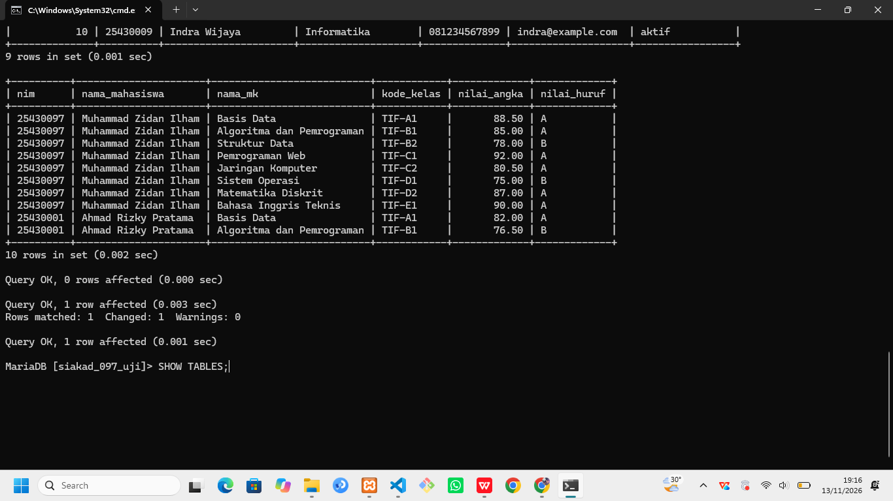

# Laporan Praktikum Basis Data — Pertemuan 8 (UTS Proyek Tahap 1)

**Nama Mahasiswa**: Muhammad Zidan Ilham  
**NIM**: 25430097  
**Kelas / Prodi**: Informatika  
**Basis Data Proyek**: `siakad_097` (Uji Bersih: `siakad_097_uji`)  

---

## 1. Tujuan & Ringkasan Integrasi Proyek (Milestone 1–7)
Pertemuan 8 merupakan evaluasi UTS Proyek Tahap 1 yang mengintegrasikan seluruh artefak pengembangan basis data dari Pertemuan 1 hingga Pertemuan 7 menjadi satu skrip instalasi bersih (`install_uts_25430097.sql`) yang dapat dipasang ulang dari nol secara konsisten.

Ringkasan lengkap tiap milestone beserta tautan berkasnya terdokumentasi pada berkas [p08_uts_25430097.md](../p08_uts_25430097.md).

---

## 2. Pengujian Instalasi Bersih (*Clean Install*)

Pengujian dilakukan menggunakan klien Command Prompt (`mysql.exe`) dengan membuat basis data baru `siakad_097_uji`, mengeksekusi skrip DDL (`p05_ddl_25430097.sql`), serta mengisi data (`p06_data_25430097.sql`) melalui satu perintah `SOURCE install_uts_25430097.sql;`.

### Bukti Tangkapan Layar Instalasi Bersih


**Hasil Verifikasi**:
- Seluruh 6 tabel (`mahasiswa`, `dosen`, `mata_kuliah`, `kelas`, `krs`, `detail_krs`) terbentuk tanpa galat (*error*).
- Seluruh *constraint* (`PRIMARY KEY`, `UNIQUE`, `FOREIGN KEY`, `CHECK`) serta populasi data 80 baris transaksi berhasil dimuat dengan akurat.

---

## 3. Catatan Modifikasi Langsung Saat Demo (Live Modification)
*(Bagian ini dicatat saat sesi ujian demo berlangsung di hadapan dosen penguji)*

- **Permintaan Modifikasi**: *(Isi sesuai soal yang dipilih dosen saat demo)*
- **Kueri SQL yang Dijalankan**:
  ```sql
  -- Tuliskan kueri modifikasi yang dikerjakan saat ujian di sini