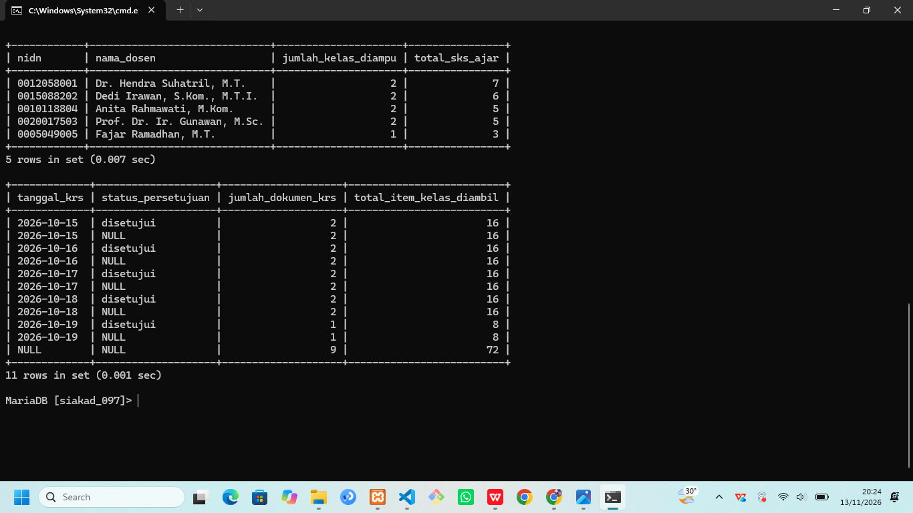

# Laporan Praktikum Basis Data — Pertemuan 9
**Topik**: Meringkas Data dengan Fungsi Agregat, `GROUP BY`, `HAVING`, dan `WITH ROLLUP`  
**Nama Mahasiswa**: Muhammad Zidan Ilham  
**NIM**: 25430097  
**Basis Data Proyek**: `siakad_097`  

---

## 1. Tujuan Praktikum
1. Menggunakan fungsi agregat (`COUNT`, `SUM`, `AVG`, `MIN`, `MAX`) dengan benar, termasuk perilakunya terhadap nilai `NULL`.
2. Mengelompokkan data menggunakan `GROUP BY` dan menyaring kelompok hasil agregasi menggunakan `HAVING`.
3. Menyusun laporan ringkasan bertingkat (subtotal dan grand total) menggunakan `WITH ROLLUP`.
4. Mencegah kesalahan semantik agregasi dengan mengaktifkan mode ketat `ONLY_FULL_GROUP_BY`.

---

## 2. Jawaban Titik Analisis & Latihan (Studi Kasus Kopma)

### Titik Analisis 1: Mengapa lebih aman menuliskan semua kolom non-agregat di `GROUP BY`?
Ketika `p.no_nota_penjualan` dihapus dari klausa `GROUP BY` saat mode `ONLY_FULL_GROUP_BY` aktif, MariaDB memunculkan **`ERROR 1055: Expression #1 of SELECT list is not in GROUP BY clause and contains nonaggregated column`**. Menuliskan seluruh kolom non-agregat di `GROUP BY` lebih aman karena menjamin konsistensi logika kelompok di berbagai versi DBMS (MySQL, MariaDB, PostgreSQL) dan mencegah kesalahan semantik ketika struktur skema atau kunci unik berubah di masa mendatang.

### Titik Analisis 2: Perbedaan `COUNT(DISTINCT p.id_penjualan)` vs `COUNT(*)`
Pada hasil penggabungan (`JOIN`) antara tabel induk `penjualan` dan tabel anak `detail_penjualan` (relasi *one-to-many*), satu nota penjualan yang memiliki 3 barang akan muncul sebanyak 3 baris. Jika menggunakan `COUNT(*)`, SQL akan menghitung jumlah baris detail barang, bukan jumlah transaksi nota. Penggunaan `COUNT(DISTINCT p.id_penjualan)` memastikan setiap nomor nota unik hanya dihitung satu kali.

### Titik Analisis 3: Syarat "Anggota Saja" di `WHERE` atau `HAVING`?
Syarat **"anggota saja"** (`WHERE p.id_anggota IS NOT NULL`) wajib ditulis di **`WHERE`**, bukan di `HAVING`. Berdasarkan urutan evaluasi SQL, klausa `WHERE` menyaring baris mentah *sebelum* proses pengelompokan (`GROUP BY`) dan perhitungan agregat dilakukan. Menyaring lebih awal di `WHERE` jauh lebih efisien secara performa dan memastikan data transaksi non-anggota tidak ikut terhitung ke dalam kelompok.

### Penjelasan Baris `NULL` pada `WITH ROLLUP` (Latihan E.2)
Pada pengelompokan `GROUP BY bulan, nama_kategori WITH ROLLUP`:
- Jika kolom `nama_kategori` bernilai `NULL` sedangkan `bulan` terisi, baris tersebut menunjukkan **subtotal omzet untuk seluruh kategori pada bulan tersebut**.
- Jika kolom `bulan` dan `nama_kategori` keduanya bernilai `NULL` (baris paling bawah), baris tersebut menunjukkan **Grand Total omzet keseluruhan** dari seluruh bulan dan seluruh kategori.

---

## 3. Implementasi Laporan Ringkasan Proyek (`siakad_097`)

Seluruh kueri ringkasan proyek disimpan pada berkas [p09_agregasi_25430097.sql](../p09_agregasi_25430097.sql) dan dieksekusi dengan mode `ONLY_FULL_GROUP_BY` aktif.

### Pemetaan Kueri terhadap Kebutuhan Informasi (KI)
1. **KI-01 (Rekap Mahasiswa Aktif per Prodi)**: Menggunakan `COUNT(*)` dan `COUNT(no_hp)` untuk memantau jumlah total mahasiswa aktif beserta kelengkapan kontak telepon per program studi.
2. **KI-02 (Statistik Nilai per Mata Kuliah)**: Menggunakan `COUNT`, `MIN`, `MAX`, dan `AVG(IFNULL(nilai_angka, 0))` untuk mengevaluasi sebaran nilai terendah, tertinggi, dan rata-rata kelas di setiap mata kuliah.
3. **KI-03 (Mahasiswa Berprestasi / `HAVING`)**: Menggunakan `AVG(dk.nilai_angka)` yang dikelompokkan per mahasiswa lalu disaring dengan `HAVING AVG(dk.nilai_angka) > 85.00` untuk menyaring hanya kelompok mahasiswa dengan rata-rata nilai di atas 85.
4. **KI-04 (Beban Mengajar Dosen / `HAVING`)**: Menggunakan `COUNT(DISTINCT kl.id_kelas)` dan `SUM(mk.sks)` untuk menghitung jumlah kelas unik dan total SKS yang diampu masing-masing dosen, disaring dengan `HAVING COUNT(DISTINCT kl.id_kelas) >= 1`.
5. **KI-05 (Ringkasan Bertingkat KRS / `WITH ROLLUP`)**: Mengelompokkan dokumen KRS berdasarkan `tanggal_krs` dan `status_persetujuan` dengan `WITH ROLLUP`, menghasilkan 11 baris yang menampilkan rincian harian, subtotal per tanggal (`status_persetujuan = NULL`), serta grand total 9 dokumen KRS dan 72 item kelas (`tanggal_krs = NULL, status_persetujuan = NULL`).

### Bukti Tangkapan Layar Eksekusi
