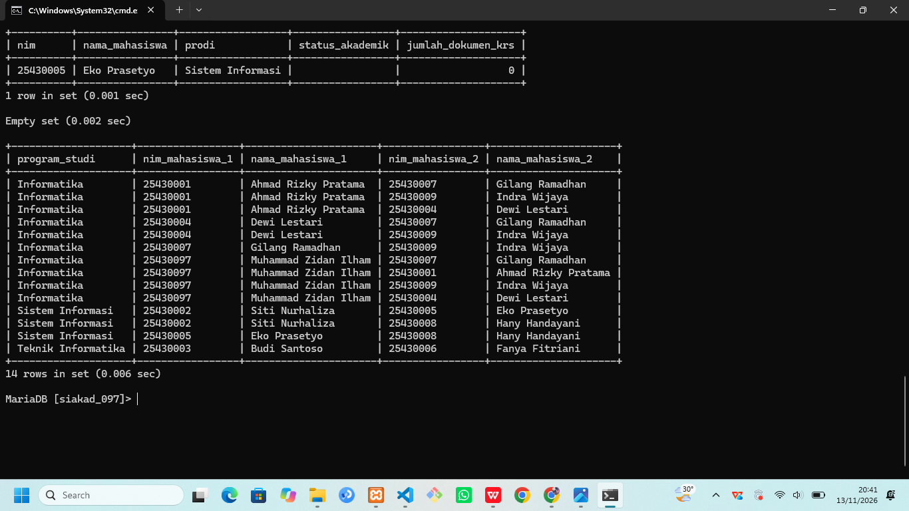

# Laporan Praktikum Basis Data — Pertemuan 10
**Topik**: Menghubungkan Tabel dengan `JOIN` (`INNER JOIN`, `LEFT JOIN`, dan `SELF JOIN`)  
**Nama Mahasiswa**: Muhammad Zidan Ilham  
**NIM**: 25430097  
**Basis Data Proyek**: `siakad_097`  

---

## 1. Tujuan Praktikum
1. Menggabungkan dua tabel atau lebih menggunakan `INNER JOIN` berdasarkan relasi kunci primer (`PRIMARY KEY`) dan kunci tamu (`FOREIGN KEY`).
2. Menggunakan `LEFT JOIN` untuk menemukan data yang tidak memiliki pasangan di tabel anak.
3. Menggabungkan operasi `JOIN` dengan fungsi agregat untuk menjawab Kebutuhan Informasi (KI) lintas tabel.
4. Mengenali dan mencegah hasil perkalian Kartesius (*Cartesian Product*) yang tidak disengaja.

---

## 2. Jawaban Titik Analisis & Latihan (Studi Kasus Kopma)

### Titik Analisis 1: Tindak Lanjut Stok Kritis Roti Cokelat
Informasi yang harus segera disampaikan kepada petugas gudang adalah **peringatan pemesanan ulang (*reorder*) segera untuk Roti Cokelat** karena produk tersebut merupakan barang terlaris di bulan Oktober (18 unit terjual), sementara stok fisiknya sudah berada di bawah batas minimum. Kueri gabungan yang diusulkan adalah menggabungkan `barang` dengan agregasi `detail_penjualan` bulan berjalan, lalu menyaring hasilnya dengan kondisi `WHERE b.stok_barang <= b.stok_minimum`.

### Titik Analisis 2: Mengapa `COUNT(*)` Menghilangkan Wafer Cokelat dari Hasil?
Pada `LEFT JOIN` antara tabel `barang` (kiri) dan `detail_penjualan` (kanan), barang yang belum pernah terjual (Wafer Cokelat) tetap muncul 1 baris dengan seluruh kolom tabel kanannya bernilai `NULL`.
- `COUNT(d.id_barang)` mengabaikan nilai `NULL`, sehingga menghasilkan `0` dan lolos syarat `HAVING COUNT(d.id_barang) = 0`.
- Sebaliknya, `COUNT(*)` menghitung **seluruh baris yang terbentuk termasuk baris yang kolom kanannya `NULL`**, sehingga menghasilkan nilai `1` dan gugur dari penyaringan `HAVING`.

### Titik Analisis 3: Cara Cepat Mendeteksi Perkalian Kartesius
Cara tercepat tanpa menghitung manual adalah dengan menjalankan perintah **`EXPLAIN`** sebelum kueri dijalankan, lalu memeriksa kolom **`type`** (jika bernilai `ALL` tanpa `Using join buffer` / syarat `ON`) dan kolom **`rows`** yang melonjak drastis jauh melebihi jumlah baris tabel transaksi utama.

---

## 3. Analisis Perbedaan Antarjenis `JOIN` pada Proyek (`siakad_097`)

Seluruh kueri relasional proyek disimpan pada berkas [p10_join_25430097.sql](../p10_join_25430097.sql) dengan jalur relasi merujuk langsung pada ERD `siakad_097`:

1. **`INNER JOIN` (KI-01 & KI-02)**:
   - Hanya menampilkan baris yang memiliki pasangan lengkap di seluruh tabel yang digabungkan. Mahasiswa seperti Eko Prasetyo yang belum memiliki dokumen KRS tidak muncul dalam daftar transkrip nilai (`KI-02`).
2. **`LEFT JOIN` untuk Data Tanpa Pasangan (KI-03 & KI-04)**:
   - Mempertahankan seluruh baris dari tabel sebelah kiri (`mahasiswa` atau `dosen`) meskipun belum memiliki pasangan di tabel sebelah kanan (`krs` atau `kelas`).
   - Pada **KI-03**, `LEFT JOIN` yang digabungkan dengan `HAVING COUNT(k.id_krs) = 0` berhasil mendeteksi **1 mahasiswa tanpa pasangan KRS**, yaitu `25430005 - Eko Prasetyo`.
   - Pada **KI-04**, `LEFT JOIN` dengan filter `WHERE kl.id_kelas IS NULL` menghasilkan `Empty set`, membuktikan seluruh 5 dosen aktif telah memiliki jadwal kelas mengajar.
3. **`SELF JOIN` (KI-05)**:
   - Menggabungkan tabel `mahasiswa` dengan dirinya sendiri menggunakan dua alias berbeda (`m1` dan `m2`) dengan syarat `m1.prodi = m2.prodi AND m1.id_mahasiswa < m2.id_mahasiswa` untuk memasangkan sesama mahasiswa satu program studi tanpa duplikasi pasangan terbalik.

### Bukti Tangkapan Layar Eksekusi
