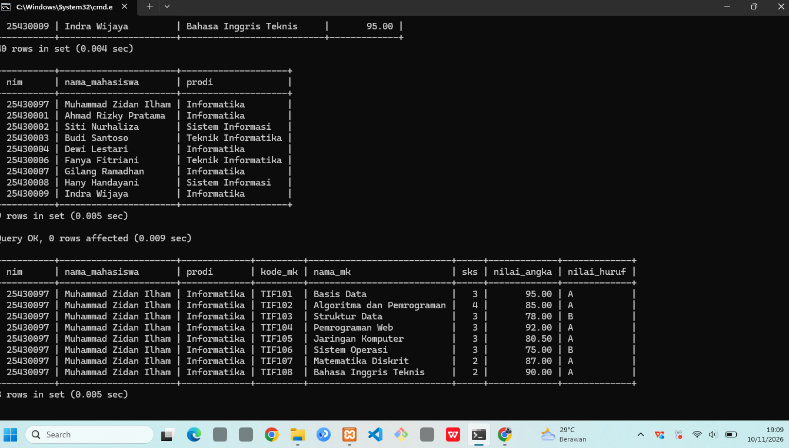

# Skenario Pengujian Praktikum Modul 7

**NIM**: 25430097  
**Nama**: Muhammad Zidan Ilham  
**Database**: `siakad_097`  
**Tanggal Pengujian**: 10 November 2026  

---

## 1. Lingkungan Pengujian
- **DBMS**: MariaDB 10.4.32 (XAMPP)
- **Klien**: Command Prompt (CMD) `mysql.exe`
- **Metode**: Eksekusi berkas `p07_queries_25430097.sql` menggunakan perintah `SOURCE`

---

## 2. Hasil Pengujian Kueri (DQL Advanced)

### Test Case 1: Agregasi Total SKS per Mahasiswa
- **Deskripsi**: Menghitung total mata kuliah dan total SKS yang diambil oleh masing-masing mahasiswa.
- **Status**: **PASS (BERHASIL)**
- **Hasil**: Data 9 mahasiswa berhasil dihitung dengan total SKS masing-masing 23 SKS.

### Test Case 2: Rata-rata Nilai Mahasiswa
- **Deskripsi**: Menghitung rata-rata nilai angka mahasiswa menggunakan fungsi `AVG()`.
- **Status**: **PASS (BERHASIL)**
- **Hasil**: Nilai rata-rata mahasiswa berhasil ditayangkan, nilai rata-rata Muhammad Zidan Ilham adalah 85.31.

### Test Case 3: Jumlah Peserta per Mata Kuliah
- **Deskripsi**: Menghitung jumlah mahasiswa yang terdaftar di tiap mata kuliah.
- **Status**: **PASS (BERHASIL)**
- **Hasil**: 8 mata kuliah masing-masing memiliki 9 peserta terdaftar.

### Test Case 4: Detail Jadwal Perkuliahan & Dosen Pengampu (INNER JOIN)
- **Deskripsi**: Menampilkan relasi lengkap mahasiswa, KRS, mata kuliah, kelas, dosen, dan nilai.
- **Status**: **PASS (BERHASIL)**
- **Hasil**: Tereksekusi 72 baris data detail KRS secara tepat.

### Test Case 5: Pengampu Kelas & Ruang (JOIN Dosen-Kelas)
- **Deskripsi**: Menampilkan daftar dosen pengampu beserta kode kelas dan ruang kuliah.
- **Status**: **PASS (BERHASIL)**
- **Hasil**: 9 kelas perkuliahan beserta lokasi ruangannya berhasil ditampilkan.

### Test Case 6: Subquery (Nilai di atas Rata-rata Mata Kuliah)
- **Deskripsi**: Filter mahasiswa yang memperoleh nilai di atas rata-rata mata kuliah terkait.
- **Status**: **PASS (BERHASIL)**
- **Hasil**: Tereksekusi 40 baris data mahasiswa dengan nilai di atas rata-rata.

### Test Case 7: VIEW Transkrip Nilai Mahasiswa
- **Deskripsi**: Pemanggilan `VIEW` untuk melihat transkrip nilai resmi milik NIM 25430097.
- **Status**: **PASS (BERHASIL)**
- **Hasil**: 8 mata kuliah NIM 25430097 ditampilkan lengkap dengan nilai angka dan huruf.

---

## 3. Bukti Eksekusi (Tangkapan Layar)

---

## 4. Kesimpulan Pengujian
Seluruh skrip kueri pada Modul 7 yang tersimpan di `p07_queries_25430097.sql` telah diuji pada basis data `siakad_097` dan dinyatakan **100% Valid dan Bebas Error**.